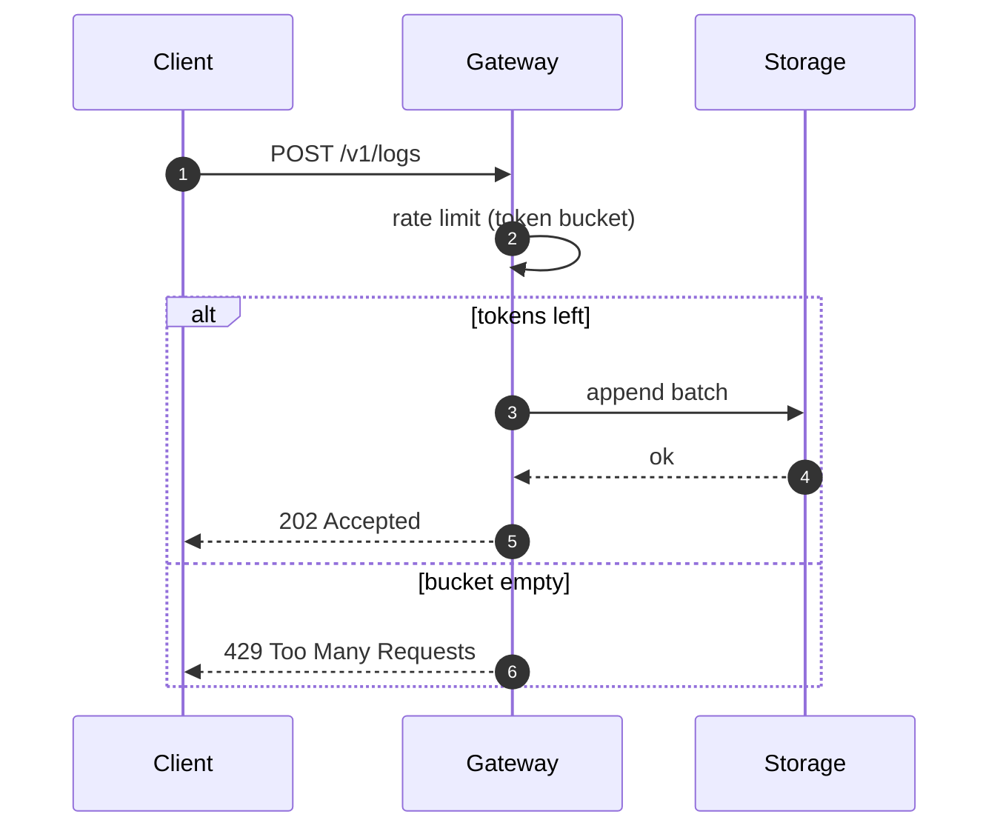
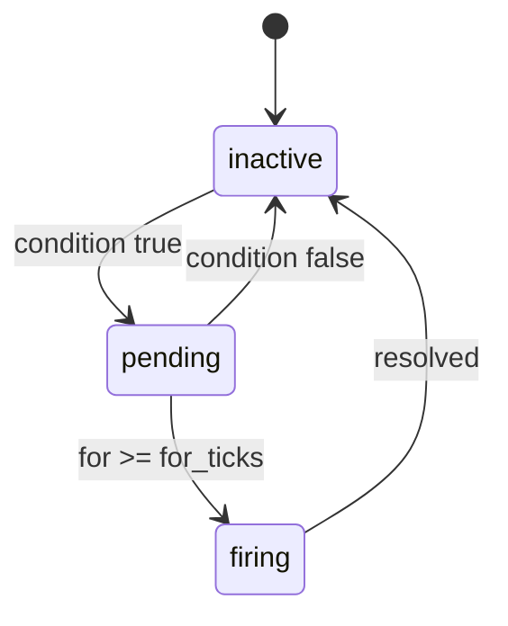
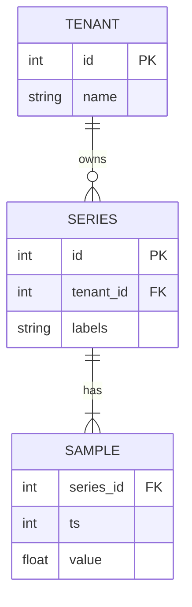

# Showcase: everything the renderer supports

> [!NOTE]
> This fixture exercises GFM, alerts, code in many languages, B-Method and Mermaid. It is used by the corpus tests.

> [!WARNING]
> Diagrams below are interactive: pinch or ⌘-scroll to zoom, drag to pan, double click to zoom in.

## Text

Paragraph with **bold**, *italic*, ~~strikethrough~~, `inline code`, a [relative link](./b-method.md#operations), an [anchor link](#tables), an autolink https://example.com and a footnote.[^1]

- [x] Task done
- [ ] Task open
  - nested item

1. First
2. Second

<details>
<summary>Raw HTML details block</summary>

Hidden content with <kbd>⌘</kbd> + <kbd>P</kbd>.

</details>


## Tables

| Component | Owner | Status | p99 latency |
| :-- | :-: | --: | --: |
| ingestion | platform | ✅ shipped | 12 ms |
| query | data | 🚧 in progress | 140 ms |
| storage | data | ✅ shipped | 4 ms |

## Code

```rust
pub fn admit(bucket: &mut Bucket, now: Instant) -> bool {
    bucket.refill(now);
    if bucket.tokens > 0 { bucket.tokens -= 1; true } else { false }
}
```

```ts
export async function render(path: string): Promise<number> {
  const t0 = performance.now();
  await view.render({ path, text: await load(path) });
  return performance.now() - t0;
}
```

```diff
- tokens := min({capacity, tokens(t) + refill})
+ tokens := tokens(t) + refill
```

```b
MACHINE Counter
VARIABLES count
INVARIANT count : 0..10
INITIALISATION count := 0
OPERATIONS
  inc = PRE count < 10 THEN count := count + 1 END;
  v <-- get = v := count
END
```

## Diagrams







<!-- expect-mermaid-errors: 1 -->

```mermaid
flowchart TD
  A[Start] --> B{Broken?
  B -->|yes| C[Fix it]
```

[^1]: Footnotes render at the bottom, like on GitHub.
