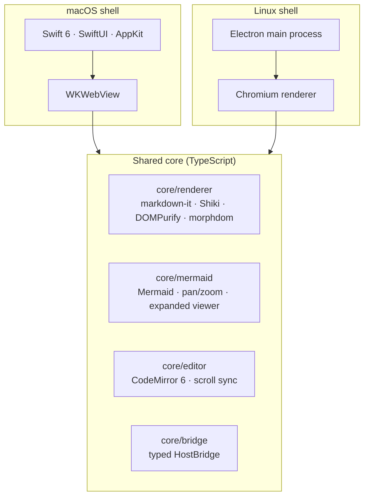
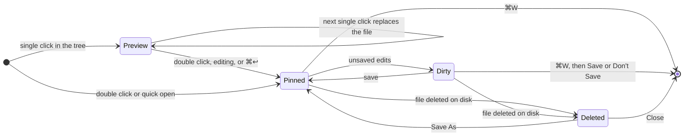
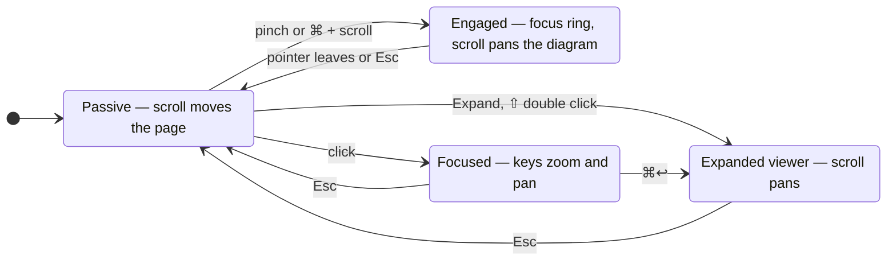
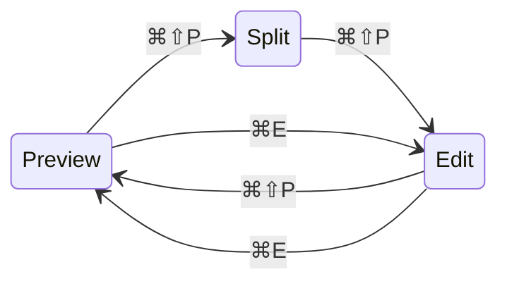
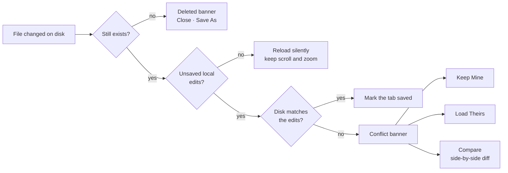
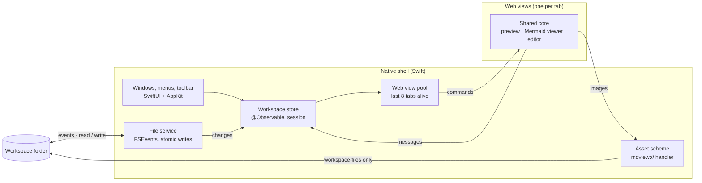
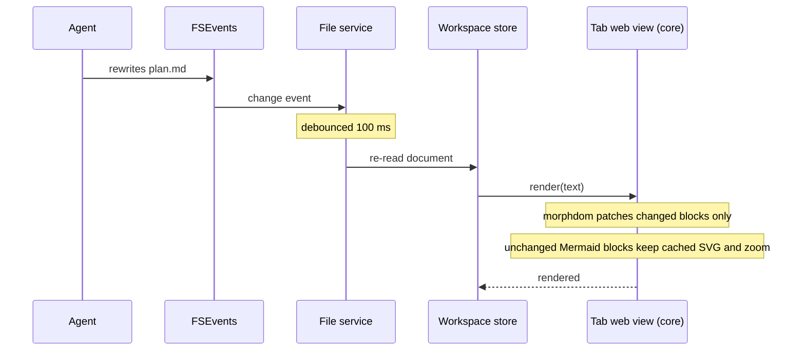
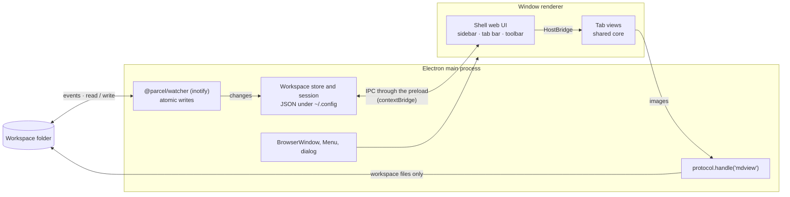
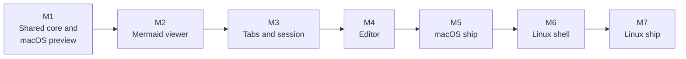

# Mermaid-First Markdown Previewer — Product Spec

*macOS native + Linux Electron · 2026-10-17 · @Yvan*

## Contents

1. [Overview](#overview)
2. [Platforms and tech stack](#platforms-and-tech-stack)
3. [Window layout and UI](#window-layout-and-ui)
4. [File tree](#file-tree)
5. [Tabs](#tabs)
6. [Markdown rendering](#markdown-rendering)
7. [Mermaid viewer](#mermaid-viewer)
8. [Editor](#editor)
9. [Settings, shortcuts, performance and security](#settings-shortcuts-performance-and-security)
10. [Architecture](#architecture)
11. [Milestones, acceptance criteria and open questions](#milestones-acceptance-criteria-and-open-questions)

## Overview

A markdown reader for project docs, built as a native macOS app and an Electron
app for Linux, whose core promise is that any Mermaid diagram, however large,
can be zoomed, panned and read comfortably. Everything else (file tree, tabs, a
light editor) exists to support reading agent-generated docs inside a repo.

**Problem.** Agent workflows produce many markdown files (plans, specs,
architecture notes) with large Mermaid diagrams. Existing previewers render
those diagrams as a fixed-size SVG squeezed into a narrow text column: labels
become unreadable and there is no zoom, pan or full-screen view. Prose columns
also waste most of a wide screen.

**Target user.** A developer on macOS or Linux who keeps a repo open while
agents write or update markdown in it, and who mostly reads, occasionally
edits.

### Goals

1. Mermaid diagrams of any size are readable: smooth pinch-zoom, pan,
   fit-to-view, full-screen.
2. Code blocks are highlighted accurately for common languages (VS Code-grade
   grammars).
3. Prose is typographically pleasant, while wide content (diagrams, code,
   tables) uses the full window width.
4. Files changed on disk by an agent re-render live, keeping scroll position
   and diagram zoom.
5. Feels at home on each platform: a native Mac app on macOS; on Linux,
   platform-correct shortcuts, menus, file dialogs and light/dark mode.

### Non-goals (v1)

- Not a knowledge base: no backlinks, graph view, tags or wikilink database.
- Not a full IDE editor: no LSP, git UI, terminal or search-and-replace across
  files.
- No sync, accounts, cloud or plugins.
- No Windows build.

## Platforms and tech stack

Two builds share one rendering core: a TypeScript package that renders
markdown, code, Mermaid and the editor, running unchanged in WKWebView on macOS
and in Chromium on Linux. Only the shell (windows, file tree, tabs, file
access, settings) is written twice.



> Throughout this spec, ⌘ means Ctrl and ⌥ means Alt on Linux, unless the
> shortcuts table says otherwise. Every behaviour in the file tree, tabs,
> rendering, Mermaid and editor sections applies to both builds.

### Shared core

| Part | Contents |
| --- | --- |
| `core/renderer` | markdown-it + plugins, Shiki, DOMPurify, morphdom, typography CSS, light/dark themes |
| `core/mermaid` | mermaid.js, pan/zoom controller, expanded viewer, minimap, export, error cards |
| `core/editor` | CodeMirror 6 setup, scroll sync |
| `core/bridge` | A typed `HostBridge` interface (messages in and out); each shell provides the implementation |
| `core/fixtures` | A corpus of real agent-written markdown and large diagrams used for snapshot tests in both engines |

The core never touches the file system or knows which shell hosts it. WebKit
and Chromium measure SVG text slightly differently, so Mermaid layout is
snapshot-tested in both.

### macOS: native shell

A Swift/SwiftUI shell with AppKit where needed, rendering the core in
WKWebView.

| Layer | Choice | Why |
| --- | --- | --- |
| Language / UI | Swift 6, SwiftUI, AppKit bridges (`NSViewRepresentable`) | Native sidebar, toolbar, menus, window restoration |
| Minimum OS | macOS 14 Sonoma | `@Observable`, mature `NavigationSplitView`; covers most active Macs |
| Rendering surface | WKWebView, one per open tab (pooled) | System WebKit: no bundled Chromium, small app, fast startup |
| Markdown parser | markdown-it + plugins (GFM tables, task lists, footnotes, anchors, front matter) | Mature, fast, extensible; runs in the web view |
| Code highlighting | Shiki with the JavaScript regex engine, grammars bundled | Same TextMate grammars and themes as VS Code; no WASM needed |
| Diagrams | mermaid.js (pinned version, bundled) | The reference Mermaid renderer |
| Pan / zoom | Custom controller (CSS transforms) | Full control over trackpad gestures and scroll conflicts |
| HTML safety | DOMPurify on rendered output | Markdown from agents may contain raw HTML |
| DOM updates | morphdom (DOM diffing) | Live reload without flicker or lost state |
| Editor | CodeMirror 6 in a web view | Markdown syntax highlighting, large-file performance, vim mode optional |
| File watching | FSEvents (`DispatchSource` / `FSEventStream`) | Efficient recursive watching of a repo |
| Distribution | Developer ID, notarized DMG; App Store optional later | No sandbox friction for arbitrary folders in v1 |

**Why native on macOS.** Electron would ship a full Chromium (~150 MB) and feel
less native in sidebars, menus and window behaviour; a fully native renderer
would have no Mermaid renderer and weak code highlighting. A Swift shell around
the shared core avoids both.

### Linux: Electron shell

An Electron app in TypeScript. On Linux there is no single native toolkit to
match, so the Chromium runtime's consistency outweighs its size, and the shell
UI (tree, tabs, toolbar) is built in the web layer.

| Layer | Choice | Why |
| --- | --- | --- |
| Runtime | Electron (current stable, pinned), TypeScript | Same Chromium on every distro; runs the core directly |
| Targets | Ubuntu 22.04+, Fedora 39+, Debian 12+; x64 and arm64; Wayland and X11 | Covers the common developer distros |
| Shell UI | Sidebar, tab bar, toolbar as a small web UI (Preact or plain TypeScript) | Light; same behaviour as the macOS spec |
| Process model | Main process: files, watching, windows, state. One renderer per window; tabs are views inside it, not one `WebContentsView` per tab | Keeps memory near the macOS budget |
| Menus, dialogs | Electron `Menu`, `dialog` (GTK / XDG portals) | Native file pickers on GNOME and KDE |
| Theme | `nativeTheme` follows the desktop light/dark setting | Matches GNOME and KDE preference |
| File watching | `@parcel/watcher` (inotify) | Scales to large repos better than chokidar |
| Local assets | `protocol.handle('mdview', …)` limited to the workspace | Same scheme and rules as macOS |
| Bridge | Preload script exposing `HostBridge` through `contextBridge` | The core cannot tell which shell it runs in |
| Fonts | System UI font for prose; a bundled monospace font (e.g. JetBrains Mono) for code | Distro mono fonts vary widely |
| Packaging | electron-builder: AppImage, .deb, .rpm; Flatpak later | Installable on all target distros |
| Updates | electron-updater for AppImage; package repos for .deb / .rpm | Standard per format |

#### Linux-specific behaviour

- Touchpad pinch reaches the page as Ctrl + wheel on Wayland. On X11, pinch is
  often unavailable, so Ctrl + scroll, double click and the toolbar are the
  guaranteed zoom paths. Launch with Wayland enabled when available.
- Many window managers grab Alt + drag to move windows, so diagram panning
  relies on plain click-drag; Alt + scroll still pans an inline diagram.
- Expanded diagram full screen is F11; the sidebar toggle is Ctrl+B (see
  shortcuts).
- Settings live in `~/.config/<app>/` as JSON; session state follows the XDG
  base directory spec.

All JavaScript and fonts are bundled in the app; the web views never load
remote resources.

## Window layout and UI

One window per opened folder (workspace): a collapsible sidebar with the file
tree on the left, a tab bar on top, and the document area filling the rest.

```text
┌───────────────────────────────────────────────────────────────────────────┐
│ ◧  my-repo  docs/plan.md                  [ Preview | Split | Edit ]  ↔ ▾ │ ← toolbar
├──────────────────┬────────────────────────────────────────────────────────┤
│ ⌕ Filter         │  plan.md  ×  │  spec.md  ●  │  notes.md                │ ← tab bar
│                  ├────────────────────────────────────────────────────────┤
│ ▾ docs           │                                                        │
│     plan.md   •  │          # Plan                                        │
│     spec.md      │          Prose stays at a readable width…              │
│ ▸ notes          │                                                        │
│   README.md      │   ┌────────────────────────────────────────────────┐   │
│                  │   │  Mermaid diagram, code block or table          │   │
│                  │   │  at window width minus 48 pt                   │   │
│                  │   └────────────────────────────────────────────────┘   │
│ Markdown only ▾  │                                                        │
└──────────────────┴────────────────────────────────────────────────────────┘
  sidebar (file tree)            document area
```

- Sidebar uses the native source-list style, resizable 180–400 pt, toggled with
  ⌃⌘S (the macOS standard).
- Toolbar holds the mode switcher (Preview / Split / Edit) and the width
  setting.
- Empty state offers Open Folder, Open File and recent workspaces.
- Drag and drop a folder onto the Dock icon or window opens it as a workspace;
  a single `.md` file opens in its parent folder's workspace.

### Using horizontal space

Prose and wide content get different widths, so text stays readable while
diagrams and code use the screen.

| Element | Readable (default) | Wide | Full |
| --- | --- | --- | --- |
| Paragraphs, lists, headings | max 80 ch, centred | max 110 ch | window width minus 48 pt padding |
| Mermaid, code blocks, tables, images | break out to window width minus 48 pt | same | same |

- Wide elements that still overflow scroll horizontally inside their own box;
  the page never scrolls sideways.
- Base font size adjustable with ⌘+ / ⌘− / ⌘0 (actual size), persisted per app.

## File tree

The sidebar shows the workspace folder as an outline that, by default,
contains only directories and markdown files, and updates live as agents
create or delete files.

Filter modes (toggle at the sidebar foot, persisted per workspace):

| Mode | Shows |
| --- | --- |
| Markdown only (default) | `.md`, `.markdown`, `.mdx` files + directories that contain at least one of them, at any depth |
| Markdown + all folders | Same files, plus empty or markdown-free directories |
| All files | Everything; non-markdown files open with the default macOS app on double-click |

Always hidden: `.git`, `node_modules`, `.DS_Store`, and paths matched by the
workspace `.gitignore` (setting, on by default). Extra ignore globs can be
added in Settings.

### Behaviour

- Folders first, then files, case-insensitive natural sort (`step-2` before
  `step-10`).
- Single click opens a file in the preview tab; double click pins it (see
  [Tabs](#tabs)).
- The selected row follows the active tab; ⌘⇧J reveals the active file in the
  tree.
- Type-to-filter field at the top: fuzzy match on file names, matching folders
  auto-expand.
- Recently changed files (modified in the last 5 minutes) show a small dot, so
  you can see what an agent just touched.
- Expansion state is persisted per workspace.

**Context menu:** New File, New Folder, Rename, Duplicate, Move to Trash, Reveal
in Finder, Copy Path, Copy Relative Path, Open in Default App.

**Watching:** one recursive FSEvents stream per workspace, events coalesced
over 100 ms; the tree diff is applied without collapsing expanded folders or
losing selection. Workspaces of 50,000 files must load the tree in under 1 s
(lazy enumeration of collapsed folders).

## Tabs

Tabs live in a custom tab bar inside the workspace window (not native window
tabs), so each workspace keeps its own set of open documents next to its file
tree.



- **Preview tab:** a single click in the tree opens the file in one reusable
  tab with an italic title; it is replaced by the next single click. Double
  click, editing, or ⌘↩ pins it.
- **Reopen:** opening a file that is already open focuses its tab.
- **Shortcuts:** ⌘W close, ⌘⇧T reopen closed, ⌃Tab / ⌃⇧Tab next / previous,
  ⌘1…⌘9 jump to tab, ⌘P quick open (fuzzy file search).
- **Order:** drag to reorder; context menu offers Close Others, Close to the
  Right, Copy Path, Reveal in Tree.
- **Overflow:** tabs shrink to a 120 pt minimum, then the bar scrolls
  horizontally with a chevron menu listing all tabs.
- **Dirty state:** a dot replaces the close button when a file has unsaved
  edits; closing asks Save / Don't Save / Cancel.
- **Deleted on disk:** the tab stays open with a struck-through title and a
  banner offering Close or Save As.
- **State per tab:** mode (Preview / Split / Edit), scroll position, and zoom
  level of each diagram.
- **Session restore:** on relaunch, each workspace reopens with the same tabs,
  active tab, modes and scroll positions.

## Markdown rendering

Rendering targets GitHub-flavoured markdown parity, so files look the way
agents and GitHub expect, with typography tuned for long reading.

### Supported syntax

- CommonMark + GFM: tables (with alignment), task lists (read-only checkboxes
  in preview), strikethrough, autolinks, footnotes.
- Heading anchors with a hover link icon; YAML front matter shown as a
  collapsible metadata table at the top.
- GitHub alerts (`> [!NOTE]`, `[!TIP]`, `[!IMPORTANT]`, `[!WARNING]`,
  `[!CAUTION]`) as styled callouts.
- Raw HTML allowed after sanitising (no scripts, iframes or event handlers).
- `<details>` / `<summary>` blocks collapse as on GitHub.
- Math (KaTeX) is out of scope for v1; listed in
  [open questions](#open-questions).

### Code blocks

- Shiki highlighting with bundled grammars for at least: Swift, Objective-C,
  TypeScript, JavaScript, JSX/TSX, Python, Go, Rust, Java, Kotlin, C, C++, C#,
  Ruby, PHP, shell/bash/zsh, SQL, JSON, YAML, TOML, HTML, CSS, Markdown,
  Dockerfile, diff, GraphQL, Terraform/HCL. Other languages load lazily from
  the bundled grammar set; unknown languages render as plain monospace.
- Theme follows system appearance (default pair: GitHub Light / GitHub Dark,
  selectable).
- Each block shows a language label and a Copy button on hover; optional line
  numbers (setting).
- `diff` blocks colour added and removed lines.
- Long lines scroll horizontally inside the block; a soft-wrap toggle per
  block.

### Typography

- System font (SF Pro) for prose, SF Mono for code; base size 16 px, line
  height 1.6, paragraph spacing 1 em.
- Clear heading hierarchy (H1 2.0 em to H6 0.9 em), H1 and H2 with a hairline
  rule.
- Tables: sticky header row when scrolling inside a tall table, zebra rows,
  horizontal scroll when wider than the window.
- Images: relative paths resolve against the file's folder; click opens a
  zoomable lightbox (same pan/zoom controller as diagrams).

### Links

- Relative links to `.md` files open in a tab (preview tab rules apply),
  including `#anchor` targets.
- In-page anchors scroll smoothly; ⌘[ / ⌘] go back / forward within a tab.
- External links open in the default browser; hover shows the URL in a status
  line.

## Mermaid viewer

Every Mermaid block renders into an interactive viewport that can be zoomed and
panned in place, and expanded to a full-window viewer for large diagrams.
Gestures must never hijack normal page scrolling: this is the main reason other
previewers feel broken.

### Inline viewport

- Full available width (wide element). Height = the diagram's natural height at
  fit-to-width, capped at 70% of the window height; a taller diagram starts
  fitted to width and shows a "tall diagram" hint.
- Diagrams smaller than the viewport render at 100%, never upscaled by default.
- A toolbar appears on hover in the top-right corner: zoom out, zoom level
  (click to reset), zoom in, Fit, Expand, more menu (Copy SVG, Copy PNG, Export
  SVG/PNG, Copy Source, View Source).
- A thin resize handle at the bottom lets the user drag the viewport taller;
  the height is remembered for that block.

### Gestures and input

The viewport becomes interactive only when the user signals intent, so
scrolling through a document never gets stuck inside a diagram.



| Input | Over an inline diagram | In the expanded viewer |
| --- | --- | --- |
| Two-finger scroll / mouse wheel | Scrolls the page | Pans |
| Pinch | Zooms around the cursor | Zooms around the cursor |
| ⌘ + scroll wheel | Zooms around the cursor | Zooms around the cursor |
| ⌥ + two-finger scroll | Pans the diagram | Pans |
| Click-drag (or Space + drag) | Pans the diagram | Pans |
| Double click | Zooms in 2× at that point | Zooms in 2× at that point |
| ⌥ + double click | Fits to viewport | Fits to viewport |
| Keys (after clicking the diagram) | + / − zoom, 0 fit, 1 actual size, arrows pan, Esc releases focus | Same, Esc closes |

- Zoom range 10%–800%, smooth (momentum on trackpad, 120 ms eased steps on keys
  and buttons).
- After the first pinch on an inline diagram, it is "engaged" (subtle focus
  ring): two-finger scroll then pans it until the pointer leaves or Esc is
  pressed.

### Expanded viewer

- Opens with the Expand button, ⌘↩ on a focused diagram, or ⇧ + double click.
  Fills the document area (not a separate window), with a dimmed backdrop; ⌃⌘F
  makes it full screen.
- Starts fitted to the view. Shows a minimap (bottom-right, toggle M) with the
  visible region draggable.
- Find in diagram (⌘F): highlights node labels matching the query and cycles
  through them with ↩, centring each match.
- Navigation between diagrams in the same file with ⌘⌥← / ⌘⌥→.

### Rendering

- Diagrams render lazily as they near the viewport (`IntersectionObserver`, 1
  screen of margin); rendered SVGs are cached by a hash of source + theme +
  Mermaid config.
- Theme follows system appearance (Mermaid default / dark, with fonts matched to
  the document); a theme change re-renders visible diagrams first.
- Rendering is kept crisp at every zoom level (vector SVG scaled with CSS
  transforms, no bitmap snapshots in v1).
- Supported types: everything the bundled Mermaid version supports (flowchart,
  sequence, class, state, ER, gantt, pie, mindmap, timeline, gitGraph, C4,
  architecture, and so on). `securityLevel: strict`.
- Live reload preserves each diagram's zoom and pan if its source is unchanged;
  a changed diagram keeps its zoom level and re-centres.

### Errors

- A syntax error renders an inline error card: Mermaid's message, the line
  number within the block, the source with that line highlighted, and an "Open
  in editor at line" button.
- The last successful render stays visible (greyed) above the error while
  editing, so a typo does not make the diagram disappear.

### Performance

- Pan and zoom at 60 fps for diagrams up to 500 nodes on an M1 MacBook Air.
- A 200-node flowchart renders in under 1.5 s; rendering never blocks scrolling
  of the rest of the page.

## Editor

Editing is deliberately light: a good plain-text markdown editor with a live
preview, enough to fix a plan or a diagram that an agent got wrong.

Modes (per tab, ⌘⇧P cycles; ⌘E toggles Preview ↔ Edit):

| Mode | Layout | Default for |
| --- | --- | --- |
| Preview | Rendered document only | Every file opened from the tree |
| Split | Editor left, preview right, draggable divider (default 50/50) | Chosen manually |
| Edit | Editor only, centred at readable width | Chosen manually |



### Editor features (CodeMirror 6)

- Markdown syntax highlighting, with fenced code blocks highlighted in their
  language and `mermaid` blocks highlighted as Mermaid.
- Soft wrap on by default, line numbers optional, current-line highlight,
  bracket matching, multiple cursors (⌥-click), find and replace in file (⌘F /
  ⌘⌥F).
- Smart lists: ↩ continues a list or task item, Tab / ⇧Tab indent; ⌘B, ⌘I, ⌘K
  for bold, italic, link.
- Native undo stack behaviour, spell check from macOS, standard text shortcuts.
- Optional vim keybindings (setting, off by default).

### Preview sync

- Preview re-renders 150 ms after typing stops; only changed blocks are patched
  in the DOM.
- Scroll sync in Split mode maps editor lines to rendered blocks (source line
  attributes from markdown-it); the editor drives, the preview follows.
  Togglable.
- Clicking a rendered block with ⌥ jumps the editor to its source line.

### Saving and external changes

- Explicit save with ⌘S; optional autosave on focus loss or after 2 s idle
  (setting, off by default). Writes are atomic (temp file + rename) and keep
  line endings and trailing newline as found.
- File changed on disk with no local edits: reload silently, keep scroll and
  diagram zoom.
- File changed on disk with unsaved local edits: a banner offers Keep Mine,
  Load Theirs, or Compare (side-by-side diff). Nothing is overwritten silently.
- Encoding: UTF-8; other encodings open read-only with a notice.



## Settings, shortcuts, performance and security

Settings stay to one native Settings window (⌘,) with three panes; everything
else has a sensible default.

### Settings

| Pane | Options |
| --- | --- |
| General | Reopen last workspaces on launch; default mode for opened files; autosave; respect `.gitignore`; extra ignore globs |
| Appearance | Content width (Readable / Wide / Full); base font size; prose font (System / New York serif); code theme light + dark; line numbers in code blocks |
| Diagrams | Inline max height (% of window); default zoom for small diagrams (100% / fit); show minimap by default; Mermaid theme override |

### Key shortcuts

All shortcuts are also in the menu bar.

| Action | macOS | Linux |
| --- | --- | --- |
| Open folder / file | ⌘O / ⌘⇧O | Ctrl+O / Ctrl+Shift+O |
| Quick open file | ⌘P | Ctrl+P |
| Toggle sidebar | ⌃⌘S | Ctrl+B |
| Reveal active file in tree | ⌘⇧J | Ctrl+Shift+J |
| Preview ↔ Edit / cycle modes | ⌘E / ⌘⇧P | Ctrl+E / Ctrl+Shift+P |
| Save | ⌘S | Ctrl+S |
| Close / reopen tab | ⌘W / ⌘⇧T | Ctrl+W / Ctrl+Shift+T |
| Next / previous tab | ⌃Tab / ⌃⇧Tab | Ctrl+Tab / Ctrl+Shift+Tab |
| Back / forward in tab | ⌘[ / ⌘] | Alt+← / Alt+→ |
| Find in document | ⌘F | Ctrl+F |
| Zoom text | ⌘+ / ⌘− / ⌘0 | Ctrl++ / Ctrl+− / Ctrl+0 |
| Expand focused diagram | ⌘↩ | Ctrl+Enter |
| Diagram full screen (expanded) | ⌃⌘F | F11 |
| Next / previous diagram (expanded) | ⌘⌥→ / ⌘⌥← | Ctrl+Alt+→ / Ctrl+Alt+← |
| Settings | ⌘, | Ctrl+, |

### Performance targets

Measured on an M1 MacBook Air, macOS 14.

| Scenario | Target |
| --- | --- |
| Cold launch to a restored workspace with 5 tabs | under 1 s to first paint |
| Open a 1 MB markdown file with 20 code blocks | first screen in under 300 ms |
| Switch tabs | under 50 ms (web views are kept alive for the last 8 tabs, the rest are discarded and restored on demand) |
| Memory with 10 open tabs | under 400 MB |

On Linux the same targets apply on a mid-range x64 laptop (4-core, 16 GB),
except cold launch under 2 s and memory under 600 MB, reflecting Electron's
baseline cost.

### Security and privacy

- No network access from web views: a strict Content-Security-Policy
  (`default-src` limited to the app's own scheme), remote images blocked by
  default with a per-document "Load remote images" banner.
- Local files are served through a custom `WKURLSchemeHandler` (`mdview://`)
  restricted to the workspace folder; no `file://` access to the rest of the
  disk.
- Rendered HTML sanitised with DOMPurify; Mermaid in strict mode (no click
  callbacks, no HTML labels with scripts).
- No telemetry. Crash reports only if the user opts in.

On Linux the Electron app is hardened the standard way: `contextIsolation` and
`sandbox` on, `nodeIntegration` off, navigation and `window.open` blocked,
Electron fuses set (no `RunAsNode`, no inspector flags), and ASAR integrity
checks enabled.

## Architecture

Swift owns the file system, state and windows; each tab's web view is a pure
renderer that receives markdown and reports user actions back.



**Bridge.** Swift calls into JavaScript with `callAsyncJavaScript` (`render`,
`setTheme`, `restoreState`, `scrollToLine`). JavaScript posts typed JSON
messages through `WKScriptMessageHandler` (`linkClicked`, `scrollChanged`,
`diagramStateChanged`, `edited`, `renderError`), versioned and validated on the
Swift side.

**Live reload flow.** FSEvents reports a change, the file service re-reads the
file (debounced 100 ms), and the workspace store updates the document. The
tab's web view receives `render`; morphdom patches only changed blocks, and
unchanged Mermaid blocks keep their cached SVG and zoom.



**Bundling.** The JavaScript lives in a small TypeScript package built with
esbuild into `renderer.js` and `editor.js`, copied into the app bundle at build
time. Library versions are pinned and updated deliberately.

### Linux mapping

The diagram above shows the macOS build. On Linux, each native box maps to an
Electron component, and the web view column is the same core code.

| Responsibility | macOS | Linux |
| --- | --- | --- |
| Windows, menus, dialogs | SwiftUI + AppKit | Electron main process: `BrowserWindow`, `Menu`, `dialog` |
| Sidebar, tab bar, toolbar | SwiftUI views | Web UI in the window's renderer |
| Workspace store, session | Swift `@Observable` store, persisted to Application Support | Main-process store, persisted as JSON under `~/.config` |
| File service | FSEvents, atomic writes | `@parcel/watcher` (inotify), atomic writes via fs rename |
| Asset scheme | `WKURLSchemeHandler` | `protocol.handle` |
| Bridge to the core | `callAsyncJavaScript` + `WKScriptMessageHandler` | Preload `contextBridge` + IPC |
| Preview, Mermaid, editor | Shared core in WKWebView | Shared core in Chromium |



Both shells implement the same `HostBridge` message set, so a feature added to
the core ships on both platforms with no shell changes unless it needs new host
capabilities.

## Milestones, acceptance criteria and open questions

Build the Mermaid viewer right after the bare preview: it is the reason the app
exists, so it should be validated on real agent-written docs before tabs and
editing.



### Milestones

1. **M1 — Shared core and macOS preview.** Core package with its `HostBridge`
   and fixture corpus, run in a plain browser harness for fast iteration. macOS
   shell: open a folder, filtered file tree with live watching, single document
   preview with GFM, Shiki and static Mermaid; width modes; light/dark.
2. **M2 — Mermaid viewer (core).** Inline viewport with the gesture model,
   toolbar, expanded viewer with minimap, find in diagram, export, error cards,
   lazy render and cache. Snapshot tests in WebKit and Chromium.
3. **M3 — Tabs and session (macOS).** Tab bar with preview tabs, quick open,
   link navigation, back/forward, session restore, live reload preserving
   state.
4. **M4 — Editor (core + macOS).** CodeMirror editor, Split/Edit modes, scroll
   sync, saving, external-change conflict banner.
5. **M5 — macOS ship.** Settings window, menus and shortcuts, performance pass,
   app icon, notarized DMG, auto-update (Sparkle).
6. **M6 — Linux shell.** Electron main process, web UI for tree, tabs and
   toolbar, `HostBridge` over IPC, settings, Linux shortcuts and gesture
   fallbacks. The core is reused unchanged.
7. **M7 — Linux ship.** Performance pass against the Linux targets, testing on
   GNOME and KDE (Wayland and X11), AppImage / .deb / .rpm packaging,
   auto-update for AppImage.

### v1 acceptance criteria

- [ ] A 300-node flowchart in a real agent-generated spec can be read node by
  node with pinch and pan, with no stutter.
- [ ] Scrolling a long document with several diagrams never gets captured by a
  diagram unless it was pinched or ⌥ is held.
- [ ] An agent rewriting the open file updates the preview within 300 ms,
  keeping scroll position and diagram zoom.
- [ ] Code blocks in the 25 listed languages highlight the same as in VS Code
  with the same theme.
- [ ] Tree in Markdown-only mode hides every folder without markdown in a
  50,000-file monorepo, and loads in under 1 s.
- [ ] Quitting and relaunching restores workspaces, tabs, modes and scroll
  positions.
- [ ] A Mermaid syntax error shows the message and offending line, and the last
  good render stays visible.
- [ ] The fixture corpus renders the same in WebKit and Chromium, within the
  snapshot tolerance.
- [ ] On Linux, every criterion above passes on Ubuntu (GNOME, Wayland) and
  Fedora (KDE), with zoom available on X11 through Ctrl + scroll and the
  toolbar.

### Open questions

- App name (the `mdview://` scheme is a placeholder).
- Math support (KaTeX) in v1 or later? Agent docs sometimes include formulas.
- Right-side outline (table of contents) panel: useful for long specs, but adds
  a feature; v1.1 candidate.
- Mac App Store distribution needs the sandbox and security-scoped bookmarks for
  folders; worth it for v1?
- Print / export whole document to PDF and HTML: needed in v1?
- Should diagrams also be rasterised at rest for very large SVGs (1,000+ nodes)
  if vector pan/zoom proves too slow?
- Build order: Linux after macOS v1 (as planned above), or both shells in
  parallel once the core is stable?
- Repo layout: one monorepo (core, macOS app, Linux app) or separate repos with
  the core published as a package?
- Flatpak / Flathub in the first Linux release, or later?
